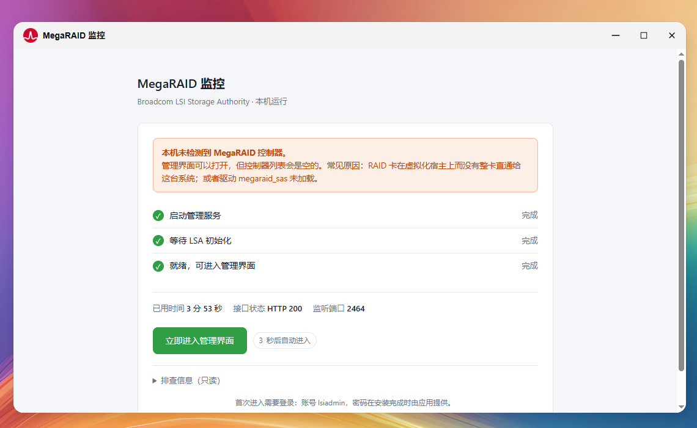
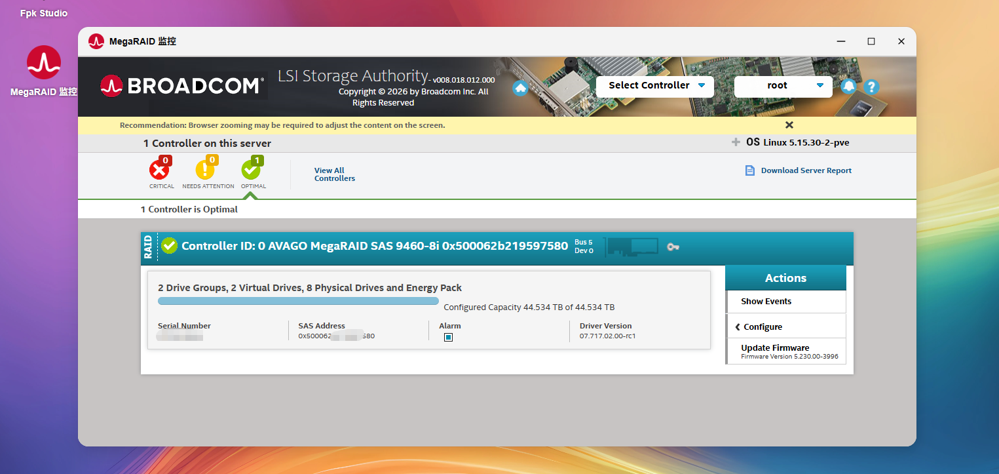

# Broadcom Controller Manager (fnOS app)

English | [中文](README.md)

GitHub: https://github.com/a10463981/LSI-Storage-Fnos ｜ Gitee: https://gitee.com/a10463981/LSI-Storage-Fnos


A fnOS application that puts the Broadcom LSI Storage Authority (LSA) console one click away,
so you can check on your MegaRAID controller without reaching for storcli, without standing up
a separate management host, and without touching the packages on your system.





## What you get

The full LSA console, read-only in practice:

- The controller itself — model, firmware, temperature, alarm state
- Virtual drives — RAID level, capacity, state, rebuild progress
- Physical drives — presence, link speed, SMART health, array membership
- Battery / cache vault — charge state and health
- Event log — when a drive dropped, when a rebuild happened

**The app is read-only.** It exposes no way to create or destroy arrays, change cache policy,
or flash firmware. What runs inside is Broadcom's own console, so LSA itself still has write
capability — "read-only" describes the entry points we provide, not a modified LSA.

## Install

```bash
sudo appcenter-cli install-fpk LSI-Storage-Fnos-0.1.03.fpk
sudo /var/apps/LSI-Storage-Fnos/cmd/main start
```

You can also use "install fpk manually" in the fnOS App Center.

| Requirement | |
|---|---|
| OS | fnOS, x86_64 |
| Disk | ~400 MB |
| RAM | ~30 MB at runtime |
| Hardware | A MegaRAID controller **visible to this machine's kernel** — bare metal, or the card passed through whole |

It installs and opens fine without a card; the UI simply reports that no controller was found,
which is handy for getting familiar with the layout first.

## First run

Open the app and you land on a password setup page:

1. Pick a username (default `lsiadmin`, changeable)
2. Choose a password, at least 8 characters, twice
3. Tick "I've written this down" and submit

A "Enter RAID management" button then appears; it takes you into LSA, where you sign in with
that account. **The first sign-in takes 20–40 seconds** (31 s measured on our test box). The
page appears frozen during that window — don't submit twice.

Forgot the password? Run `sudo /var/apps/LSI-Storage-Fnos/cmd/reset-password` and reopen the app.

Two extra buttons cover day-to-day hiccups: **Re-check environment** runs a quick self-test
(runtime, driver, ports, API, logs), and **Restart management service** bounces the LSA backend
with live progress on the page.

## How it works

The app ships a trimmed Ubuntu root filesystem with Broadcom's LSA already installed inside it.
On start we `chroot` into it inside a private mount namespace, so LSA's nginx and management
services run in their own little world — nothing is installed into your fnOS system, and
uninstalling simply removes a directory.

A small Python portal (~20 KB, standard library only) sits in front. It handles account setup,
watches for LSA to actually become ready, and gets you into the console. It listens on a TCP
port and on a unix socket for the fnOS panel gateway, which is why both
`http://<host>:2463/` and the desktop icon (`/app/LSI-Storage-Fnos`) work.

Ports: 2463 for the portal, 2464 for the LSA console; the rest belong to LSA itself.

## Known limitations

- **Fully validated only on a machine without a card.** Controller enumeration, drive state,
  rebuild progress and battery reporting all need real hardware to confirm.
- **Not supported:** fnOS running in a VM with the controller left on the host and not passed
  through — the kernel can't see the card, and neither can the LSA inside.
- LSA's front end is plain HTTP; the login password crosses your LAN in the clear. Keep it on
  a trusted network.
- Whether `readonly_access_groups` actually blocks write operations has not been verified on
  real hardware.

## Notice and license

This is an **unofficial third-party integration**. It is not affiliated with, endorsed by, or
authorized by Broadcom Inc. Broadcom, LSI, MegaRAID and LSI Storage Authority are trademarks or
registered trademarks of Broadcom Inc.

Our own code is MIT licensed. **The published fpk bundles Broadcom's proprietary LSA binaries**
(the LSA installer, everything under `/opt/lsi`, and the Ubuntu root filesystem). Those remain
the property of Broadcom and Canonical and are not covered by the MIT license; the fpk is meant
for personal use on hardware you own. If the binary distribution is ever taken down, the source
repository is unaffected — bring your own LSA installer and build the fpk as described there.
