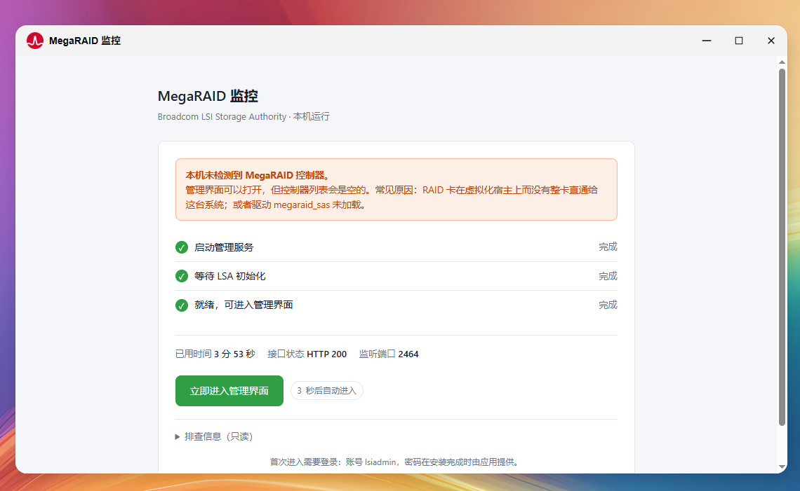
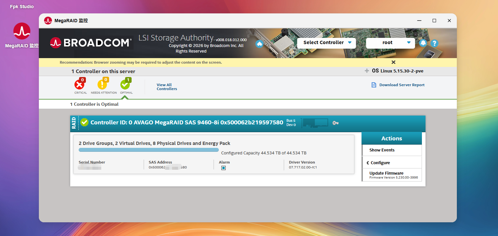

# 博通控制器管理（fnOS 应用）

[English](README.en.md) | 中文

在 fnOS 上装一个应用，点开就是 Broadcom LSI Storage Authority（LSA）的图形界面，用来查看
MegaRAID 阵列卡的状态。不用 storcli，不用在外网另找一台机器装管理端，也不用动你系统里的软件包。

> 姊妹项目：Debian / PVE 版本见 [LSI-Storage-PVE v0.1.03](https://github.com/a10463981/LSI-Storage-PVE)。





## 它能做什么

打开后是一套完整的 LSA 控制台，可以看：

- 控制器本身：型号、固件版本、温度、告警状态
- 虚拟盘（VD）：RAID 级别、容量、当前状态、是否在重建
- 物理盘（PD）：在位情况、转速、SMART 健康、所属阵列
- 电池 / 电容（BBU/CV）：充电状态与健康
- 事件日志：什么时候掉过盘、什么时候重建过

**它是只读的**：应用本身不提供创建或删除阵列、改缓存策略、刷固件的入口。
不过界面里跑的是 Broadcom 原版控制台，LSA 自身具备写能力——"只读"指的是我们不提供操作入口，
不等于把 LSA 改造成了只读工具。

## 安装

```bash
sudo appcenter-cli install-fpk LSI-Storage-Fnos-0.1.03.fpk
sudo /var/apps/LSI-Storage-Fnos/cmd/main start
```

也可以直接在 fnOS 应用中心里选「手动安装 fpk」。

| 前提 | 说明 |
|---|---|
| 系统 | fnOS x86_64 |
| 磁盘 | 约 400 MB |
| 内存 | 运行期约 30 MB |
| 阵列卡 | 需要 MegaRAID 卡，且**本机内核能看到它**（裸机，或整卡直通给 fnOS） |

没有卡也能装、能打开，界面会明确提示"未检测到控制器"，用来先熟悉界面没问题。

## 第一次用

装完点开应用，第一屏是设置登录口令：

1. 填账号名（默认 `lsiadmin`，可以改）
2. 填口令，至少 8 位，输两遍
3. 勾选「我已记下这个口令」→ 提交

之后页面上会出现「进入 RAID 管理界面」按钮，点它进入 LSA，用刚才那个账号登录。
**首次登录要等 20–40 秒**（本机实测 31 秒），期间界面没反应是正常的，别重复提交。

忘了口令就在终端执行 `sudo /var/apps/LSI-Storage-Fnos/cmd/reset-password`，重新打开应用重设。

页面上还有两个按钮应付日常小问题：「重新检测环境」跑一遍自检（运行环境、驱动、端口、接口、日志）；
「重启管理服务」把 LSA 后端重启一遍，页面会显示重启进度。

## 工作原理

应用里自带一个精简的 Ubuntu 根文件系统，里面装好了 Broadcom 官方的 LSA。启动时用 `chroot` 把它
运行在独立的挂载命名空间里，LSA 的 nginx 与管理服务都在这个环境中跑，和你系统的软件包互不干扰，
卸载时整个目录删掉即可。

外层有一个很小的 Python 门户（约 20 KB，只用标准库），负责三件事：设定账号口令、探测 LSA 什么时候
真正就绪、把用户送进 LSA 界面。它同时监听 TCP 端口和一个面板网关用的 unix socket，所以无论是直接
访问 `http://<地址>:2463/`，还是从 fnOS 桌面点图标（走 `/app/LSI-Storage-Fnos` 反代），都能进来。

端口占用：2463 给门户，2464 给 LSA 界面，另有内部端口由 LSA 自己使用。

## 已知限制

- **只在无卡环境完整验证过**。控制器枚举、虚拟盘/物理盘状态、重建进度、电池信息这些需要有真卡才能确认。
- **不支持** fnOS 跑在虚拟机里、阵列卡在宿主机且未直通的情况——这种情况下内核看不到卡，里面的 LSA 也看不到。
- LSA 前端是明文 HTTP，登录口令过局域网时是明文传输。建议只在内网使用。
- 只读组配置（`readonly_access_groups`）是否真的拦住写操作，还没有在真卡上验证过。

## 声明与许可

本项目是**非官方第三方集成**，与 Broadcom Inc. 没有隶属关系，也未获其授权或背书。
Broadcom、LSI、MegaRAID、LSI Storage Authority 是 Broadcom Inc. 的商标或注册商标。

代码部分以 MIT 许可发布。**发布出来的 fpk 里包含 Broadcom LSA 的专有二进制**（LSA 安装包、
`/opt/lsi` 下的组件、Ubuntu 根文件系统），仅面向个人在自己硬件上使用的场景；这部分版权归
Broadcom 与 Canonical，不在 MIT 范围内。如果这个分发包被要求下架，源码仓库不受影响——
你可以自备 LSA 安装包，按仓库里的构建说明自行编译出 fpk。
